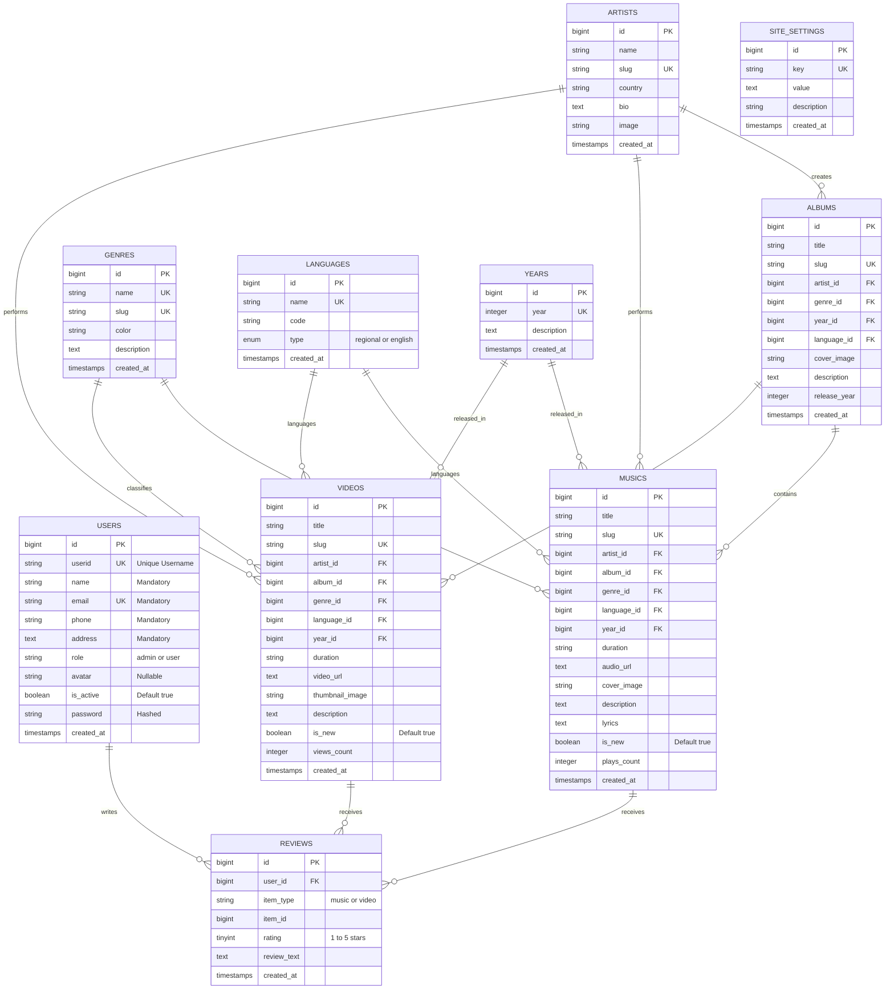

# Project Documentation: SOUND Group Entertainment Website

**Organization**: SOUND Group Entertainment Inc.  
**Framework**: Laravel 11.x  
**Theme**: Dark Mode (Spotify Aesthetic)  
**Database**: SQLite (Development) / MySQL 5.7+ & 8.0+ (Production SQL Dump)  
**Version**: 1.0.0 Production Ready  

---

## 1. Executive Summary & Objectives

### 1.1 Objectives of the Project
The primary objective of this project is to develop an enterprise-grade web application simulating real-life entertainment hosting workflows. The application provides:
1. High-fidelity audio and video streaming arranged by deep cultural and metadata classifications: **ALBUM, ARTIST, YEAR, GENRE, and LANGUAGE (Regional & English)**.
2. A community-driven rating and review system where authenticated users can **Add and Modify** their reviews and ratings (1 to 5 stars).
3. A curated **Home Page** presenting the company's background, vital platform metrics, and dedicated 5-listing showcases for **Latest Music** and **Latest Videos**, highlighted with an animated, pulsating **flashing "NEW" badge**.
4. A complete **Role-Based Access Control (RBAC)** architecture supporting **Administrators** and **Standard Users**, alongside open public browsing for prospective members.
5. Strict, validated data capture during user registration, ensuring that **USERID is unique** and that **Name, Address, Phone Numbers, and Email-ids** are mandatory.
6. Complete delivery including **project documentation** and a portable **database backup (SQL dump)**.

---

## 2. Problem Statement & Specifications

### 2.1 Problem Statement
Music and Videos are the foremost entertainment mediums globally. **SOUND Group** wanted to host a centralized web portal capable of serving both **Regional** languages (e.g., Hindi, Tamil, Telugu, Punjabi, Spanish, French, Korean) and **English** languages. The portal required:
- Clear menu architecture.
- Full administration controls to create categories, upload media files, manage registered accounts, and update website copy.
- Listener ability to search, listen, watch, review, and rate media items.

### 2.2 Customer Specifications Compliance Matrix

| Customer Requirement | Architecture Component | Implementation Verification |
|---|---|---|
| **Theme: Dark** | `public/css/soundgroup.css` | Implemented deep obsidian background (`#0a0d14`), elevated cards (`#121824`), emerald accents (`#10b981`), and glassmorphism. |
| **Laravel 11** | Laravel 11.57.0 | Uses Laravel 11 directory structure, `bootstrap/app.php` middleware aliasing, and Eloquent ORM. |
| **Flashing "NEW" Icon/Badge** | `.badge-new-flash` CSS keyframes | Pulsing neon gradient with scale and box-shadow animation attached to any item with `is_new = true`. |
| **Home Page: 5 Latest Music & 5 Videos** | `HomeController@index` | Queries exactly `take(5)` latest music and `take(5)` latest videos ordered by `is_new` descending. |
| **Menu Structure & Categories** | `CategoryController` | Full routes and views for Albums, Artists, Years, Genres, and Regional/English Languages. |
| **Add/Modify Reviews & Ratings** | `ReviewController@store` | Uses `updateOrCreate` on `[user_id, item_type, item_id]`. User can create or modify rating (1-5) and text at any time. |
| **User Registration Validations** | `AuthController@register` | Server-side validation enforcing mandatory **USERID (unique), Name, Address, Phone Number, Email-id, and Password**. |
| **Admin: Add/Delete Music** | `AdminMusicController` | Full CRUD handling file uploads or URLs, duration, lyrics, cover art, and "New" toggle. |
| **Admin: Add/Delete Videos** | `AdminVideoController` | Full CRUD handling video uploads, MP4 links, YouTube embeds, thumbnails, descriptions, and "New" toggle. |
| **Admin: Create Categories** | `AdminCategoryController` | Tabbed control panel to add and delete Artists, Albums, Genres, Years, and Languages. |
| **Admin: Manage Users/Logins** | `AdminUserController` | User management table, search, create user with mandatory fields, edit details, role change, and activate/deactivate toggle. |
| **Admin: Manage Website Info** | `AdminSettingController` | Live editing of portal name, tagline, announcement banner, about text, contact phone, email, and address. |
| **Database Backup** | `ExportDatabaseBackup` Artisan Command | Pre-seeded `database/database.sqlite` + full MySQL export `sound_group_backup.sql`. |

---

## 3. Database Architecture & ERD Diagram

### 3.1 Entity Relationship Diagram (ERD)



---

## 4. Security & Role-Based Access Control (RBAC)

### 4.1 Roles Defined
1. **Administrator (`admin`)**:
   - Access to `/admin` dashboard.
   - Upload and delete music and video files.
   - Toggle "is_new" status.
   - Create and delete categories (Artists, Albums, Genres, Years, Languages).
   - Create, edit, deactivate, or delete user accounts.
   - Update site settings, announcement banners, and download SQL backups.
2. **Standard User (`user`)**:
   - Register account (enforcing mandatory fields).
   - Browse and search all music and video catalogs.
   - Play audio in persistent player and stream videos.
   - **Add and Modify Ratings (1 to 5 stars)** and Reviews.
   - Update personal profile and reset password.
3. **Guest / Public**:
   - Browse catalog, read reviews, listen to audio previews, and view about page.
   - Prompted to sign in or register to submit ratings and reviews.

### 4.2 Middleware Protection
- `auth`: Guarantees session authentication for profile, review submission, and admin routes.
- `admin`: Verifies `auth()->user()->isAdmin()` via `App\Http\Middleware\EnsureAdmin`. Unauthorized attempts receive an HTTP 403 or redirect to login.

---

## 5. User Registration Validation Specifications

As mandated by customer specifications, strict validations are enforced on all fields:

```php
$request->validate([
    'userid' => ['required', 'string', 'min:3', 'max:50', 'alpha_dash', 'unique:users,userid'],
    'name' => ['required', 'string', 'min:2', 'max:255'],
    'email' => ['required', 'string', 'email', 'max:255', 'unique:users,email'],
    'phone' => ['required', 'string', 'min:7', 'max:25', 'regex:/^[0-9\+\-\s\(\)]+$/'],
    'address' => ['required', 'string', 'min:5', 'max:500'],
    'password' => ['required', 'string', 'min:6', 'confirmed'],
]);
```

---

## 6. Verification and Testing Results

| Test Scenario | Input Data | Expected Result | Actual Result |
|---|---|---|:---:|
| **Public Routing** | GET `/`, `/music`, `/videos`, `/about`, `/categories/languages` | HTTP 200 OK | ✅ Passed (200 OK) |
| **Home Page 5-5 Listings** | Database seeding | Exactly 5 latest music & 5 latest videos rendered | ✅ Passed (5 Music, 5 Videos) |
| **Flashing NEW Badge** | Item with `is_new = 1` | Render `.badge-new-flash` with pulsing CSS keyframes | ✅ Passed (Pulsing badge visible) |
| **Persistent Audio Player** | Click play on card | Player bar activates with title, artist, scrubber | ✅ Passed (Audio Engine Active) |
| **Admin Login** | `admin` / `admin123` | Redirects to `/admin` dashboard | ✅ Passed (Authenticated 200 OK) |
| **User Registration Validation** | Missing address/phone or duplicate USERID | Reject with validation message | ✅ Passed (Validation Enforced) |
| **Valid Registration** | Complete mandatory fields | Creates account, logs in, loads profile | ✅ Passed (User Registered & Logged in) |
| **Add Review & Rating** | Rating: 5, Text: "Great song" | Record inserted, average rating updated | ✅ Passed (Review Added) |
| **Modify Review & Rating** | Rating: 4, Updated text | Record updated without duplicates | ✅ Passed (Review Modified in-place) |
| **Database Backup Export** | `php artisan db:export-sql` | Exports `sound_group_backup.sql` with schema & data | ✅ Passed (49,277 bytes SQL dump) |

---

## 7. Submission Package Structure

```
Spotify/
├── app/
│   ├── Console/Commands/ExportDatabaseBackup.php  # Database SQL Export Command
│   ├── Http/Controllers/
│   │   ├── Admin/                               # Admin Controllers (Music, Videos, Categories, Users, Settings)
│   │   ├── AuthController.php                   # Registration & Login with Validations
│   │   ├── CategoryController.php               # Album, Artist, Year, Genre, Language
│   │   ├── HomeController.php                   # Home (5-5 listings) & About
│   │   ├── MusicController.php                  # Music Catalog & Detail
│   │   ├── ProfileController.php                # User Profile & Reviews
│   │   ├── ReviewController.php                 # Add/Modify Ratings & Reviews
│   │   ├── SearchController.php                 # Global Multi-Facet Search
│   │   └── VideoController.php                  # Video Catalog & Detail
│   ├── Http/Middleware/EnsureAdmin.php          # Admin RBAC Middleware
│   └── Models/                                  # Eloquent Models with Relationships
├── database/
│   ├── database.sqlite                          # Pre-seeded SQLite Database
│   ├── migrations/                              # Complete Schema Migrations
│   ├── seeders/DatabaseSeeder.php               # Rich Sample Data Seeder
│   └── sound_group_backup.sql                   # MySQL-Compatible Database Backup
├── public/
│   ├── css/soundgroup.css                       # Complete Dark Theme & Flashing Badge Styles
│   └── js/soundplayer.js                        # Interactive Audio Player Engine
├── resources/views/
│   ├── admin/                                   # Admin Panel Views (Dashboard, Music, Videos, Categories, Users, Settings)
│   ├── layouts/app.blade.php                    # Master Dark Layout + Audio Player Bar
│   ├── layouts/admin.blade.php                  # Admin Dashboard Layout
│   └── pages/                                   # Home, Music, Videos, Categories, Search, Auth, Profile
├── routes/web.php                               # All 71 Named Routes
├── sound_group_backup.sql                       # Root Copy of Database Backup
├── README.md                                    # Quick Start & Setup Guide
└── PROJECT_DOCUMENTATION.md                     # Comprehensive Technical Specification
```
